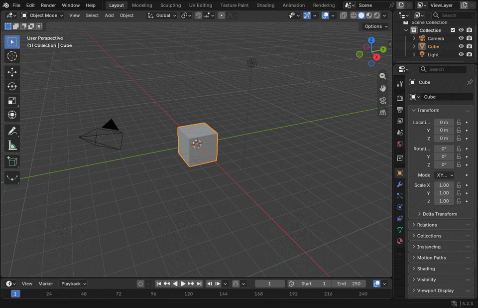
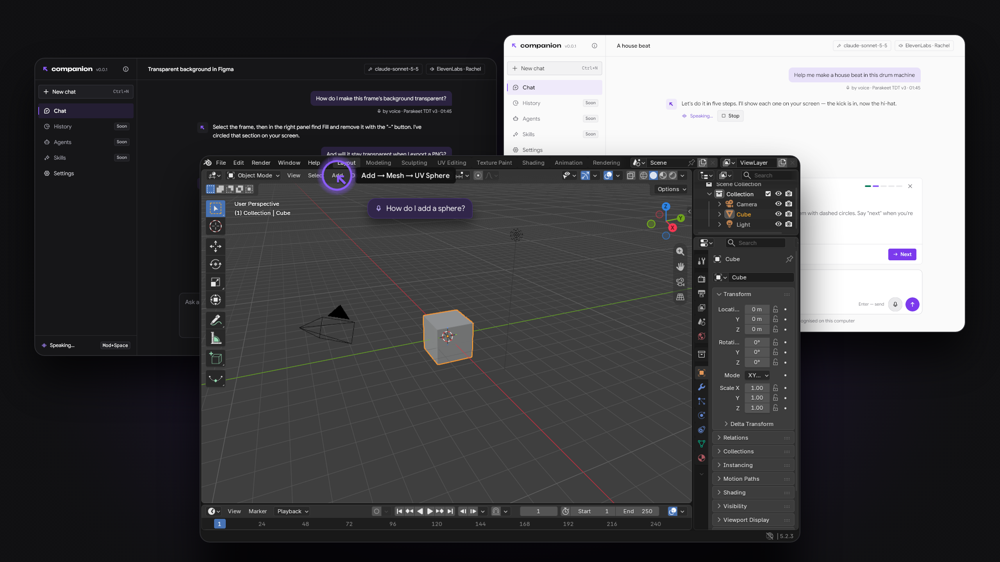

<p align="center">
  
</p>

<p align="center">
  <a href="https://github.com/xlsft/companion/releases/latest"></a>
  <a href="https://github.com/xlsft/companion/actions/workflows/ci.yml"></a>
  <a href="LICENSE.md"></a>
</p>

**The friend who knows everything.** Ask how to do anything. Companion watches your screen with you and guides you
step by step.

- **Just ask out loud.** Press a key, ask about whatever is in front of you, and hear the answer.
- **It shows you where to click.** A ring and a pointer appear right over the button you need.
- **Private.** Your voice stays on your computer, you use your own AI key, and there is no account.

## Install

```sh
curl -fsSL https://raw.githubusercontent.com/xlsft/companion/main/install.sh | sh
```

Or with Homebrew: `brew install xlsft/tap/companion`, or [download the latest release](https://github.com/xlsft/companion/releases/latest).

Runs on Linux today; Windows and macOS are on the way. Start Companion from your menu, follow the short setup, then
press <kbd>Super</kbd>+<kbd>Space</kbd> and ask.

## What it does

<p align="center">
  
</p>

- **Talk or type.** Hold the key and speak, or write in the chat window. Interrupt the answer any time.
- **Step by step.** For longer tasks it walks you through one step at a time and waits until you are ready.
- **Looks only when you ask.** One picture of the screen at the moment of your question, never a recording.
- **Speaks your language.** 13 languages, light and dark look.

<p align="center">
  
</p>

## Questions

**Is it free?**
Yes. You pay only your AI provider for what you use, or nothing at all with a model running on your own computer.

**Which AI can I use?**
Anthropic (Claude), OpenAI and compatible services, or local models through Ollama or LM Studio. You paste your
own key once; it is kept in your system's keychain.

**Does my voice leave my computer?**
No. Speech is turned into text on your computer. Only the text of your question, and the one picture of your screen,
go to the AI you chose. Details in [SECURITY.md](SECURITY.md#what-leaves-your-computer).

**Which languages?**
The interface comes in 13 languages, and you can speak to it in yours.

---

[Build from source](docs/development.md) · [Linux details](docs/linux.md) · [Security and verifying downloads](SECURITY.md) ·
[Contributing](CONTRIBUTING.md)

Licensed under [FSL-1.1-ALv2](LICENSE.md): free to use, and each release becomes Apache 2.0 two years after it ships.
