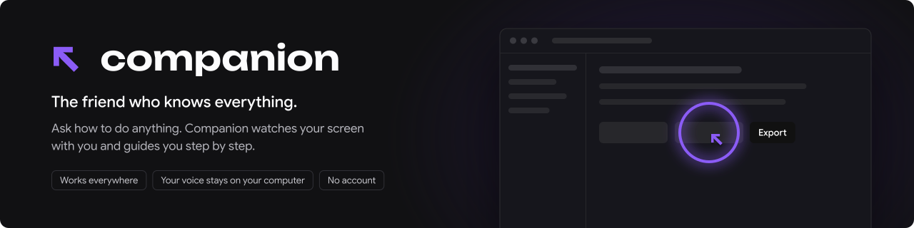
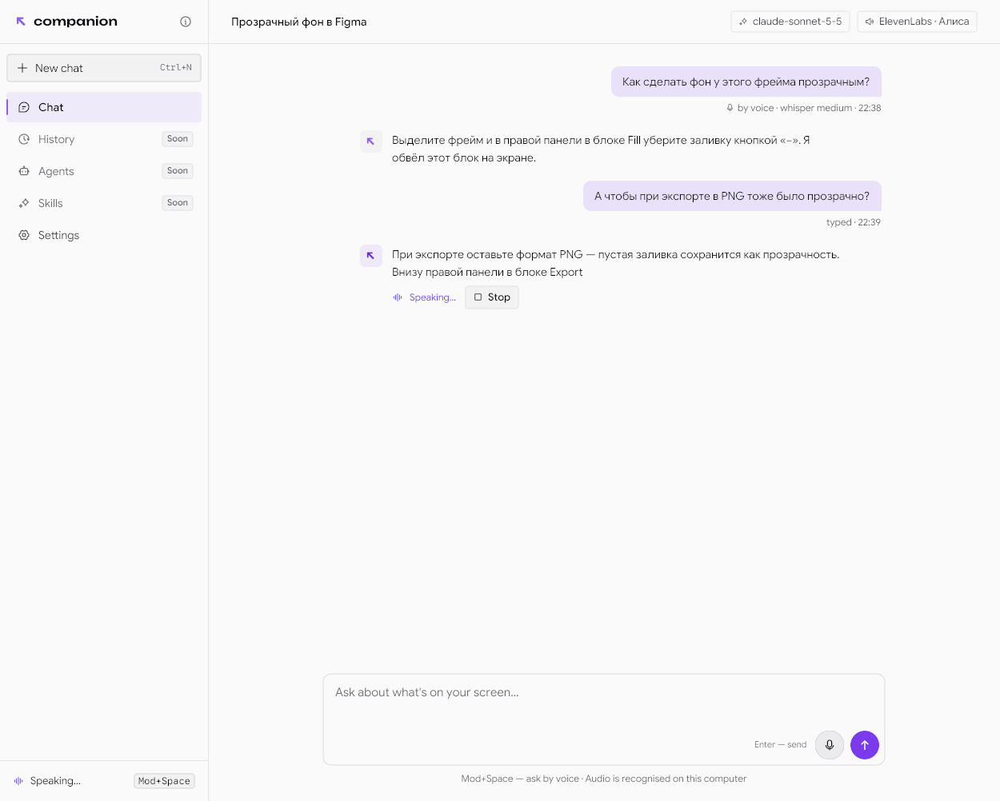
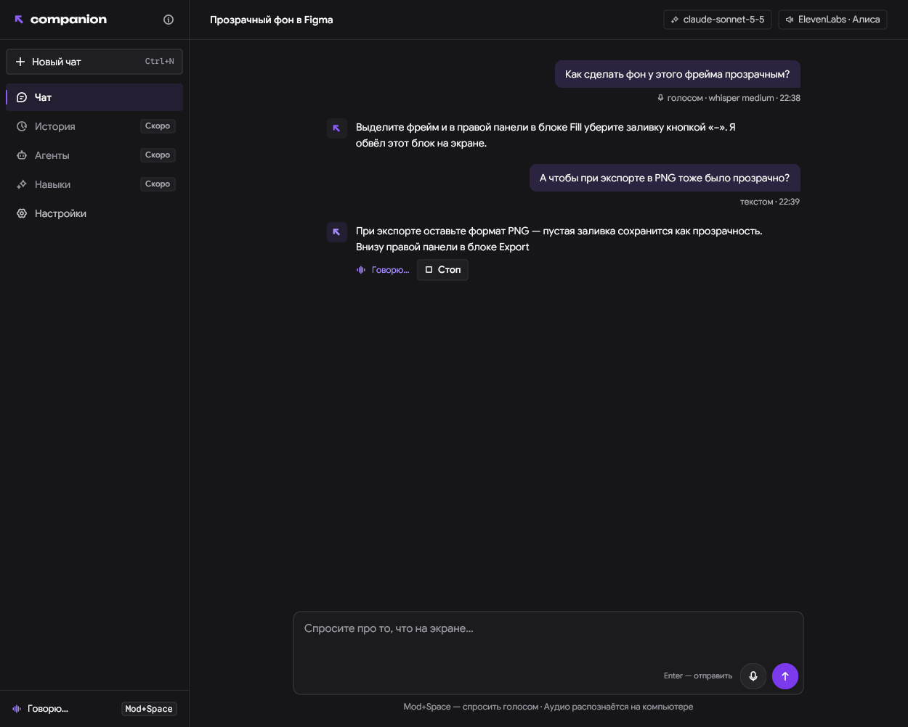
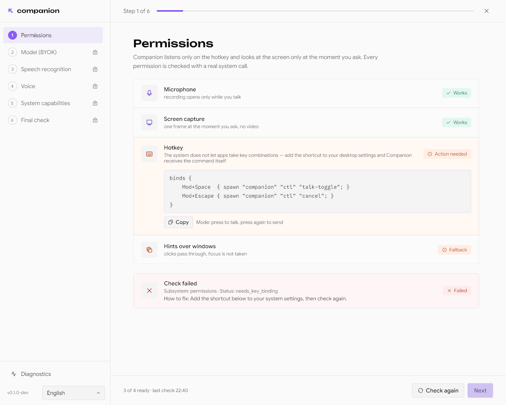
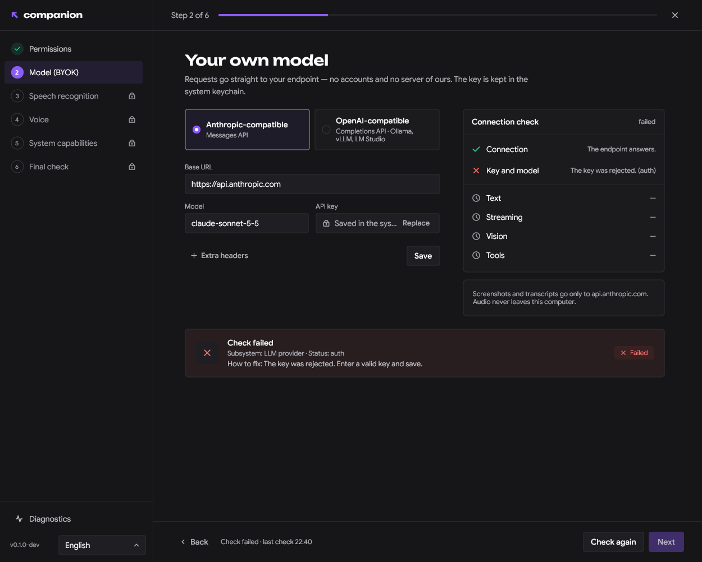
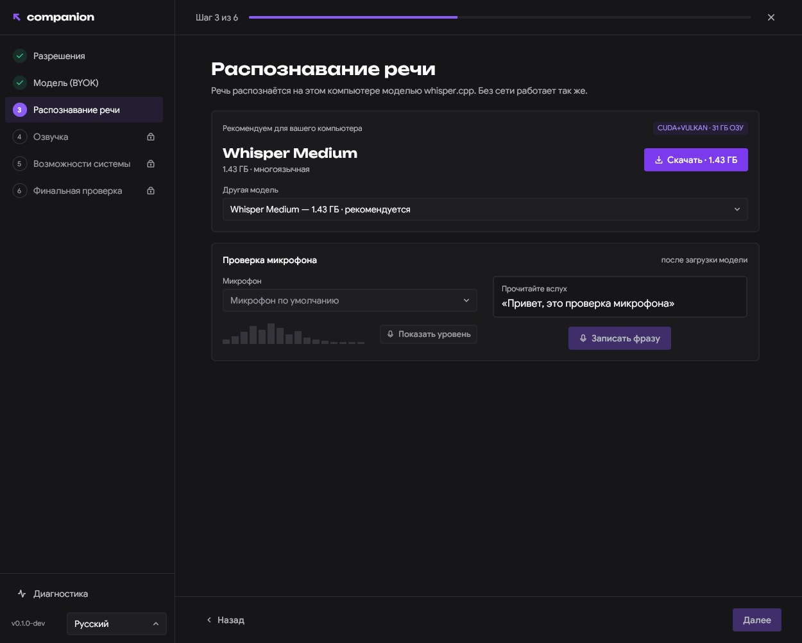
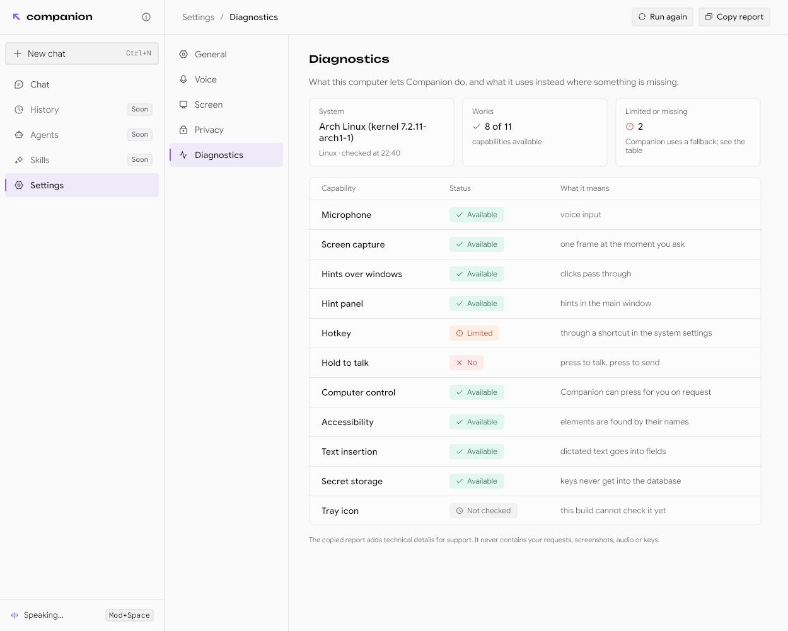
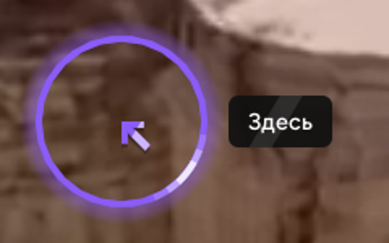
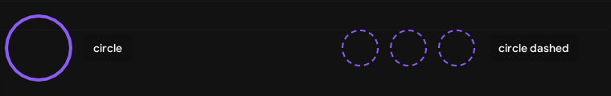
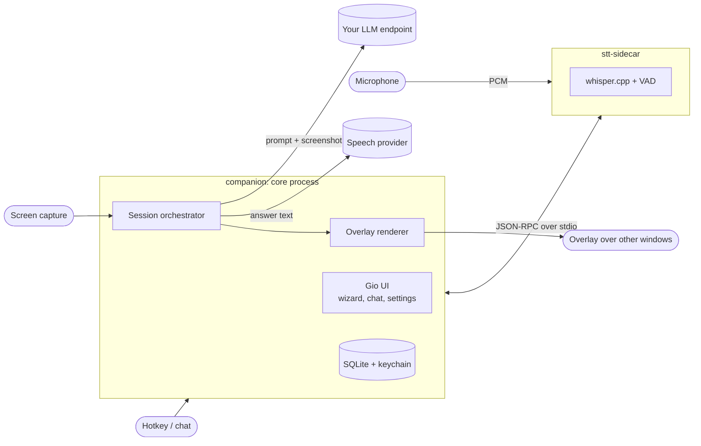

<p align="center">
  
</p>

<p align="center">
  <a href="https://github.com/xlsft/companion/actions/workflows/ci.yml"></a>
  <a href="https://github.com/xlsft/companion/releases/latest"></a>
  
  
  <a href="LICENSE.md"></a>
</p>

**Companion** is a desktop assistant you talk to about what is on your screen. Press a hotkey, ask a question, and it
answers out loud and points at the right place with an overlay. Speech is recognised on your computer, the model is
yours (any Anthropic- or OpenAI-compatible endpoint), and there is no server of ours in between.

- **Voice or text**: a global hotkey (push-to-talk or toggle) or the chat window
- **Looks at the screen only when you ask**: one frame at the moment of the question, no recording
- **Points at things**: rings, arrows, outlines and labels drawn over other windows, click-through
- **Local speech recognition** with [whisper.cpp](https://github.com/ggml-org/whisper.cpp) in a separate process; the model
  is picked for your hardware and downloaded on first run
- **Bring your own key**: Anthropic Messages API or OpenAI-compatible Completions (OpenAI, Ollama, vLLM, LM Studio …);
  keys live in the system keychain
- **Spoken answers** through ElevenLabs or an OpenAI-compatible speech endpoint, interruptible at any time
- **Setup wizard and diagnostics** that check every permission and capability with a real system call and say what the
  fallback is when something is missing
- **13 interface languages**, light and dark themes

## Screenshots

<table>
  <tr>
    <td width="50%"></td>
    <td width="50%"></td>
  </tr>
  <tr>
    <td></td>
    <td></td>
  </tr>
  <tr>
    <td></td>
    <td></td>
  </tr>
</table>

<p align="center">
  
  
</p>

## Install

Linux, x86_64 or aarch64. The installer downloads the latest release, checks its SHA-256 and, if
[cosign](https://docs.sigstore.dev/cosign/system_config/installation/) is installed, its signature, then installs into
`~/.local`:

```sh
curl -fsSL https://raw.githubusercontent.com/xlsft/companion/main/install.sh | sh
```

| Variable | |
|---|---|
| `VERSION=0.1.0` | install that release instead of the latest |
| `PREFIX=/opt/companion` | install somewhere else than `~/.local` |
| `REQUIRE_SIGNATURE=1` | refuse to install unless cosign verifies the signature |
| `GITHUB_TOKEN=…` | use a token for the GitHub API (rate limits) |

Run the same command again to upgrade. To remove it (settings and models in `~/.config/openclick` stay):

```sh
curl -fsSL https://raw.githubusercontent.com/xlsft/companion/main/install.sh | sh -s -- --uninstall
```

Other ways:

- **Homebrew** (Homebrew on Linux): `brew install xlsft/tap/companion`
- **Tarball**: download `companion-<version>-linux-x86_64.tar.gz` from [Releases](https://github.com/xlsft/companion/releases),
  extract it, then run `./companion` in place or `./install.sh` (`PREFIX=/usr` as root for system-wide)
- **AppImage**: `Companion-<version>-x86_64.AppImage` from the same page
- **Arch Linux**: [`packaging/PKGBUILD`](packaging/PKGBUILD) builds from a checkout: `cd packaging && makepkg -si`

Runtime dependencies (EGL, Wayland/X11, PipeWire or PulseAudio, xdg-desktop-portal, a Secret Service provider) are
listed per distribution in [docs/linux.md](docs/linux.md#runtime-dependencies).

### Verify a release

Releases are signed keylessly with [Sigstore](https://www.sigstore.dev) by this repository's release workflow:
`checksums.txt` covers every asset and has a `checksums.txt.sigstore.json` bundle.

```sh
cosign verify-blob checksums.txt --bundle checksums.txt.sigstore.json \
  --certificate-identity-regexp '^https://github.com/xlsft/companion/.github/workflows/release.yml@refs/tags/v.*$' \
  --certificate-oidc-issuer https://token.actions.githubusercontent.com
sha256sum --ignore-missing -c checksums.txt
```

## Quick start

1. Run `companion` (or pick Companion in the app menu). The setup wizard opens.
2. **Permissions**: microphone, screen capture, hotkey and overlay are each checked for real. Where the desktop does not
   let apps grab a key combination, the wizard shows the binding to paste into your compositor or desktop settings
   (`companion ctl talk-toggle`); see [docs/linux.md](docs/linux.md#binding-the-hotkey-without-a-portal).
3. **Model**: enter a base URL, model and API key. The wizard checks text, streaming, vision and tool use.
4. **Speech recognition**: download the recommended whisper model and say the test phrase.
5. **Voice**: pick a speech provider and voice, or leave answers as text.
6. Press **Mod+Space** and ask about what is on the screen.

`companion -diagnose` prints the capability report of the current desktop as JSON, which is also the first thing to
attach to a bug report.

## How it works



- `companion` is the core: a [Gio](https://gioui.org) UI, the session state machine, the LLM and speech clients,
  storage, and thin per-platform bridges (portals, wlr-layer-shell, X11, PipeWire, AT-SPI, Secret Service).
- `stt-sidecar` runs whisper.cpp in its own process, so a native crash or a GPU backend failure costs one request,
  not the app. The core supervises and restarts it. Protocol: [docs/stt-protocol.md](docs/stt-protocol.md).
- Capabilities are detected from facts (session type, portals, Wayland globals), never from the desktop's name; a
  missing one is reported as unsupported with a fallback instead of failing silently.

Architecture decisions: [docs/adr/0001-desktop-architecture.md](docs/adr/0001-desktop-architecture.md).

## Privacy

- **No backend, no account, no telemetry.** Companion talks only to the endpoints you configure.
- **Audio never leaves the computer.** Speech recognition is local; only the recognised text is sent to your model.
- **Screenshots** are taken only when you ask, one frame, and sent only to your model endpoint. By default they are kept
  in memory and never written to disk; storing them with the chat history is an opt-in setting.
- **Keys** are stored in the system keychain (Secret Service), never in the database or config files.
- **Logs** contain technical codes only: no prompts, transcripts, screen content, audio or keys. The diagnostics report
  you can copy follows the same rule.

## Platform support

| Platform | Status |
|---|---|
| Linux, Wayland (GNOME, KDE Plasma, sway, Hyprland, niri, other wlroots compositors) | Supported; capabilities vary by compositor and portal backend, see [docs/linux.md](docs/linux.md#capability-profiles) |
| Linux, X11 | Supported |
| Windows | Not yet: platform backends are not implemented, no release builds |
| macOS | Not yet: platform backends are not implemented, no release builds |

Release binaries are built on Ubuntu 24.04 and need glibc 2.39 or newer (Ubuntu 24.04, Debian 13, Fedora 40 and
later, Arch); on older systems build from source.

## Building from source

Go (version in [go.mod](go.mod)), a C toolchain, CMake, and the development headers of Wayland, X11, xkbcommon,
EGL/GLES and PipeWire. On Debian or Ubuntu:

```sh
sudo apt install build-essential cmake pkg-config libwayland-dev libx11-dev libx11-xcb-dev \
  libxkbcommon-x11-dev libgles2-mesa-dev libegl1-mesa-dev libffi-dev libxcursor-dev libxfixes-dev \
  libvulkan-dev libpipewire-0.3-dev libspa-0.2-dev
git clone --recurse-submodules https://github.com/xlsft/companion
cd companion
make whisper          # once: static whisper.cpp libraries (uses the GPU/BLAS backends it finds)
make build build-whisper
./bin/companion
```

| Target | |
|---|---|
| `make build` | native cgo build of everything, binaries in `bin/` |
| `make test`, `make vet` | unit tests and vet (no network, fake HTTP servers) |
| `make cross` | pure-Go packages for windows, darwin and linux |
| `make whisper build-whisper` | whisper.cpp and the real speech sidecar (`make build` alone gives a fake engine) |
| `make dist-linux` | release tarball and AppImage in `dist/` |

## Contributing

Bug reports, ideas and pull requests are welcome; see [CONTRIBUTING.md](CONTRIBUTING.md). Contributors sign the
[CLA](CLA.md) once, by commenting on their first pull request. Security issues: [SECURITY.md](SECURITY.md).

## License

[Functional Source License 1.1, Apache 2.0 future license](LICENSE.md) (`FSL-1.1-ALv2`). You may use, modify and
redistribute Companion for any purpose except offering a competing product or service; each release becomes available
under Apache 2.0 two years after it is published. Third-party notices: [packaging/NOTICE](packaging/NOTICE).
