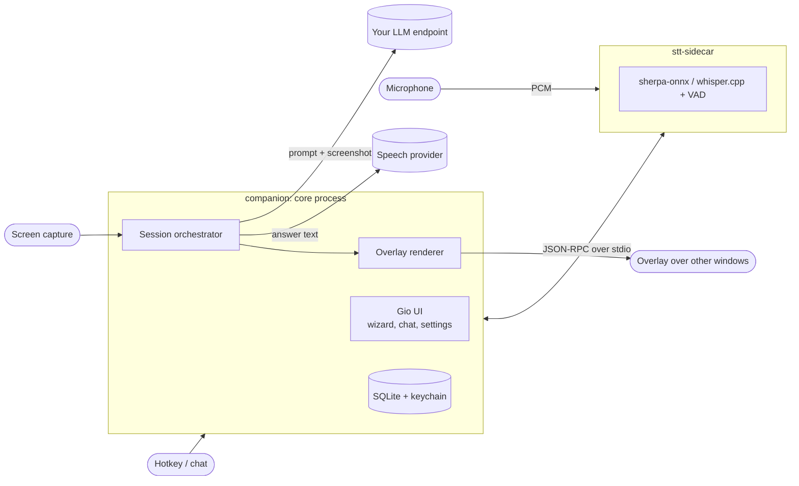

# Development

## Building from source

Go (version in [go.mod](../go.mod)), a C toolchain, CMake, and the development headers of Wayland, X11, xkbcommon,
EGL/GLES and PipeWire. On Debian or Ubuntu:

```sh
sudo apt install build-essential cmake pkg-config libwayland-dev libx11-dev libx11-xcb-dev \
  libxkbcommon-x11-dev libgles2-mesa-dev libegl1-mesa-dev libffi-dev libxcursor-dev libxfixes-dev \
  libvulkan-dev libpipewire-0.3-dev libspa-0.2-dev
git clone --recurse-submodules https://github.com/xlsft/companion
cd companion
make whisper          # once: static whisper.cpp libraries (uses the GPU/BLAS backends it finds)
make build build-whisper
./bin/companion
```

| Target | |
|---|---|
| `make build` | native cgo build of everything, binaries in `bin/` |
| `make test`, `make vet` | unit tests and vet (no network, fake HTTP servers) |
| `make cross` | pure-Go packages for windows, darwin and linux |
| `make whisper build-whisper` | whisper.cpp and the real speech sidecar (`make build` alone gives a fake engine) |
| `make dist-linux` | release tarball and AppImage in `dist/`, see [linux.md](linux.md#building-the-packages) |

`companion -diagnose` prints the capability report of the current desktop as JSON; attach it to bug reports.

## How it works



- `companion` is the core: a [Gio](https://gioui.org) UI, the session state machine, the LLM and speech clients,
  storage, and thin per-platform bridges (portals, wlr-layer-shell, X11, PipeWire, AT-SPI, Secret Service).
- `stt-sidecar` runs speech recognition in its own process, so a native crash or a GPU backend failure costs one
  request, not the app. The core supervises and restarts it. Protocol: [stt-protocol.md](stt-protocol.md).
- Capabilities are detected from facts (session type, portals, Wayland globals), never from the desktop's name; a
  missing one is reported as unsupported with a fallback instead of failing silently.

Architecture decisions: [adr/0001-desktop-architecture.md](adr/0001-desktop-architecture.md).

## README visuals

Everything in `docs/assets` is generated, so it can be redone when the UI changes:

```sh
go run packaging/genbanner.go > docs/assets/banner.svg            # -variant a|b|c, b is the README banner
go run packaging/genbanner.go -h 640 > /tmp/social.svg && rsvg-convert /tmp/social.svg -o docs/assets/social-preview.png
go run packaging/genscreens.go -raw DIR -out docs/assets          # screenshots.png and demo.gif
```

`genscreens` takes 1180×760 window captures in `DIR`:

- `chat-dark.png`: `bin/mainui -theme dark -lang en -state chat`
- `guide-light.png`: `bin/mainui -theme light -lang en -state chat -guide running`
- `app.png`: a real application with neutral content (currently Blender started with `--factory-startup`); the
  question, target and label drawn over it are set in `scene` at the top of `genscreens.go`.

Build the spikes with `go build -tags=novulkan -o bin/ ./cmd/spikes/mainui ./cmd/spikes/wizard` and capture only the
window you started (on niri: float it, set its size to 1180×760, `niri msg action screenshot-window --id …`). The
social preview is uploaded by hand in the repository settings; GitHub has no API for it.
